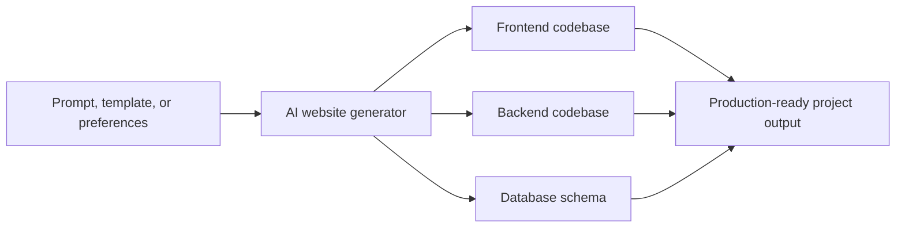

# SiteCraft

## Project contribution

Explores prompt-driven website generation by translating product ideas and preferences into a coordinated frontend, backend, and data design.

## Architecture


AI Website Generator: Generate production-ready codebases (frontend, backend, DB) from prompts, templates, or design preferences.

## 🌟 Features
### ✨ AI-Powered Code Generation

- **HTML Generator:** Builds semantic and structured layouts.

- **CSS Styling:** Creates modern, mobile-friendly designs.

- **JavaScript Interactivity:** Adds dynamic functionality when needed.

### 🎨 Flexible Inputs

Generate websites based on:

- **Text prompts** (e.g., “Make a portfolio site with three sections: About, Projects, Contact”)

- **Predefined templates**

- **User-provided design preferences**

### 🖥️ Multi-Stack Website Output

- **Frontend:** React + Tailwind

- **Backend:** Flask/FastAPI (Python) or Express.js (Node.js)

- **Database:** SQLite (for simplicity)

## 🔹 Tech Stack

- **Frontend (UI for user input):** Gradio

- **Backend for AI logic:** Python (FastAPI or Flask)

- **LLM:** Gemini 1.5 Flash via API

- **Website Output Stack:**
  - Frontend: React + Tailwind
  - Backend: Flask/FastAPI (Python) or Express.js (JavaScript)
  - Database: SQLite

## 🚀 Quick Start

### 1. Install Dependencies
```bash
pip install -r requirements_sitecraft.txt
```

### 2. Set Up API Keys
Create a .env file in the project directory with:
```env
OPENAI_API_KEY=your_openai_api_key_here
GEMINI_API_KEY=your_gemini_api_key_here
```

### 3. Run SiteCraft
Open website_generator.ipynb in Jupyter Lab or Notebook and run all cells.
Alternatively, launch the Gradio UI if integrated:
```bash
python app.py
```

### 4. Export Your Website
Save the generated output as .html or a full React + Tailwind project and open it in your browser.

## 📂 Project Structure
├── website_generator.ipynb        # Main notebook

├── .env                           # API keys (ignored in GitHub)

└── README.md                      # Project documentation

